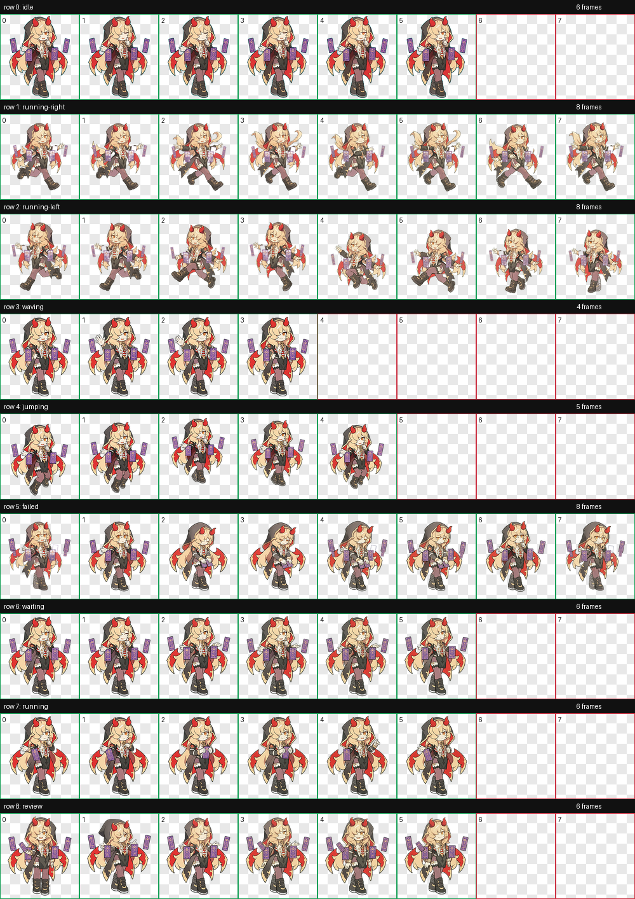

# Kiriko Grand Priestess Codex Pet

A fan-made animated desktop pet for Codex, inspired by Kiriko in her Grand Priestess style from *Overwatch*. This is an unofficial, non-commercial fan project.

[Watch the animation overview](overview.gif)

## What it does

- Adds a custom character to Codex as a lightweight animated pet.
- Includes nine animation states: idle, running, running left and right, jumping, waving, waiting, review, and failed.
- Provides a transparent 8 × 9 WebP spritesheet and a Codex-compatible `pet.json` manifest.
- Includes an overview GIF, a contact sheet, and individual GIF previews for each animation.

## Install

Copy this folder to `%USERPROFILE%\.codex\pets\arcana`, then reload Codex and enable the pet in its pet settings.

## Files

- `pet.json` — pet name, description, and spritesheet reference.
- `spritesheet.webp` — 1536 × 1872 atlas, arranged as 8 columns × 9 rows (192 × 208 pixels per cell).
- `animation-previews/<state>.gif` — individual animation previews, such as `animation-previews/idle.gif` and `animation-previews/running-left.gif`.
- `contact-sheet.png` and `overview.gif` — visual previews of the character and animations.
- `validation.json` — spritesheet validation details.

## Credits

Character artwork is based on an image supplied by the project owner. Animation frames were generated and assembled for this fan-made Codex pet. *Overwatch* and Kiriko are the property of their respective owners; this project is not affiliated with or endorsed by Blizzard Entertainment.
